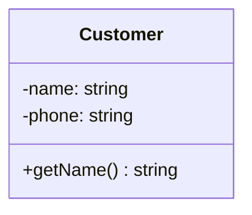
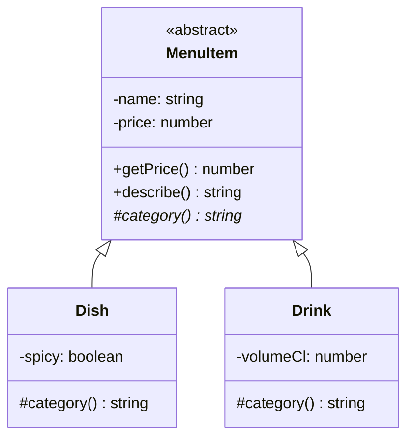
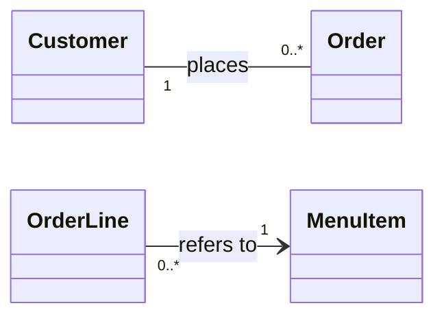
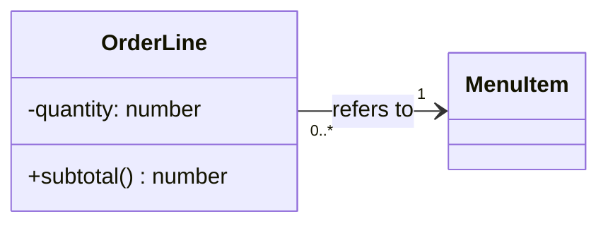
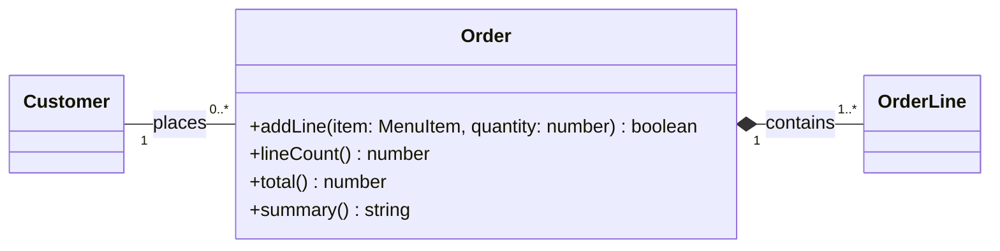
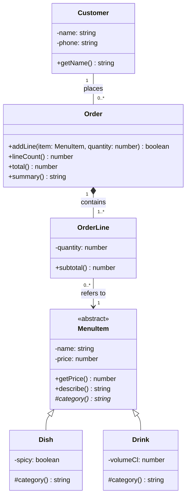
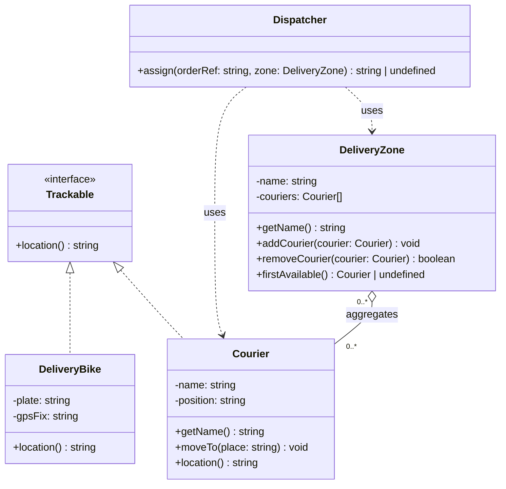

## Step 1

## Step 2
## Step 3

## Step 4

**Prediction 1.**
| Line | Will it be underlined in red? Which symbol in the diagrams of Steps 1 and 3 tells you? | The error message |
|---|---|---|
| (a) |yes,because menuItem is abstract so we cannot instanciate directly | Error: Cannot create an instance of an abstract class.|
| (b) | yes, because category is protected so it is not accessible from outside the class| Error: Property 'category' is protected and only accessible within class 'Dish' and its subclasses.|
| (c) |yes, name is private so only accessible inside Customer |Error: Property 'name' is private and only accessible within class 'Customer'. |

## Step 5

**Question 1.** 
- (a) Can a customer exist without ever having placed an order? -->YES
- (b) Can one order belong to two customers?-->NO
- (c) Can Bissap appear in many order lines?-->YES
- (d) Can one order line refer to two menu items?NO

## Step 6

**Question 2.**
--> Without OrderLine, we wouldn't be able to store the quantity of each menu item in an order. For example if Awa orders 2 thieboudieune, with only the menu item, we would only see that she wants a thieboudieun but not the exact quantity.OrderLine allows us to associate each MenuItem with its quantity and calculate its subtotal.

## Step 7

**Question 3.**
-->Because an Order and OrderLine respect the `has a` relationship and OrderLine cannot exist without Order. While OrderLine refers to MenuItem but MenuItem exist idependently from it.

## Step 8

**Question 4.** 
--> (a)no,my code is not wrong because the diagram says each customer can have 0 to many orders.And in the code, we can see that each order takes customer as a parameter meaning  each order will belong to one customer.
   (b)Neither of the diagram and the code are wrong, but they disagree about if an empty order is allowed.Since the constructor creates an empty array and add lines afterward, I would change the diagram from 1..* to 0..*

## Part B diagram

## Step 10

**Prediction 2.**
--> it will print "moussa" then "undefined" and "moussa" "Medina"
**Question 5.**
--> const plateau = new DeliveryZone("Plateau");
    const medina = new DeliveryZone("Médina");
    plateau.addCourier(moussa);
    Those lines show that moussa can exist independently of a deliveryZone because he can be removed from one zone and added to another without being destroyed. So having a composition here is wrong because a Courrier can exist independently of their zone.The best on is aggregation. 

## Step 11
**Question 6.**
--> To justify a solid line to deliveryZone, we must use DeliveryZone as an attribute instead of a parameter so that i won't be a dependency anymore.

## Step 12
**Question 7.**
| Relationship | Line number in `dispatch.ts` | That line of code |
|---|---|---|
| `Courier` realizes `Trackable` | 5 | `class Courier implements Trackable {` |
| `DeliveryBike` realizes `Trackable` | 27 | `class DeliveryBike implements Trackable {` |
| `DeliveryZone` aggregates `Courrier` | 45 | ` private couriers: Courier[] = []` |
| `Dispatcher` uses `Courier` | 73 | `const courier = zone.firstAvailable();` |
| `Dispatcher` uses `DeliveryZone` | 72 | `assign(orderRef: string, zone: DeliveryZone)` |

## Step 13
**Prediction 3.**
**Checkpoint 13**
-->Fatou's total changed although nobody touched her order because she shared the same object as Awa, so when awa choose something, they will both have it meaning Fatou's total will change without we touch it.

## Step 14
**Question 8.**
-->Instead of each OrderLine belonging to eaxctly one Order, the same OrderLine can now belong to multiple Orders which is breaking the composition relationship. `getLines()` allows Orders to acces to OrderLine objects and `addExistingLine()` will take an OrderLine from another order and adds it instead of creating a new one. 

## Step 15
## Step 16
**Question 9.**
-->The `is-a` tes fails first because a courier is not a customer.They have different responsibilities even though they share some same attributes.The substitution test fails because a Courier cannot replace a customer.The stability test also fails because they have different reponsibilities.
I would keep Customer and Courrier as independant classes because they are independant.