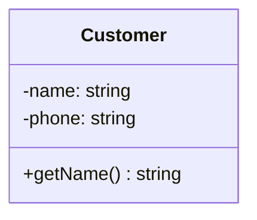
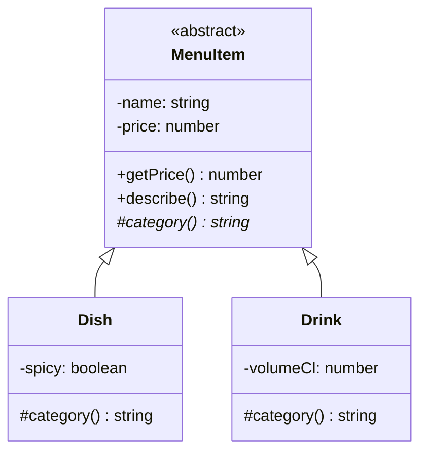
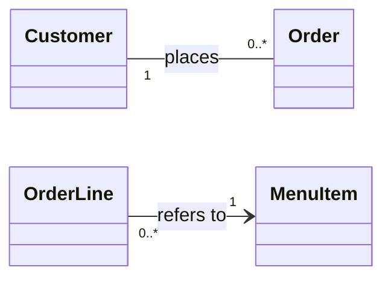
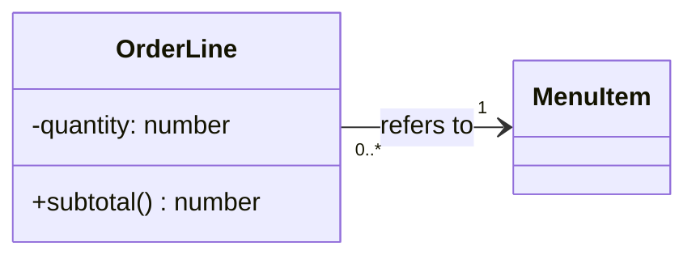
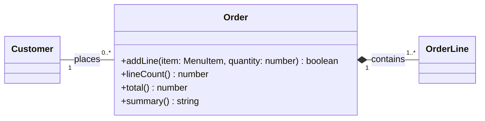
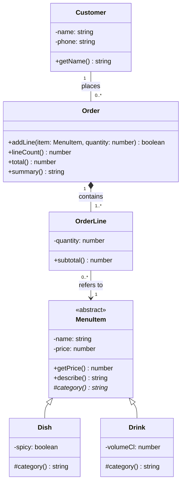

# Object-Oriented Programming — DAUST Fall 2026

# Lab 5 — UML, Part 1: Class Diagrams

A neighbourhood restaurant takes orders by phone and delivers them by courier. You will build its class diagram **one symbol at a time**: read a symbol, turn it into code, and check. Then you go the other way, from code to diagram, watch a diagram stop telling the truth, and finally design a model of your own, again in small steps.

Parts A and B are done in the session. Parts C, D and E are homework, due with the deliverables.

Working method:

1. **One step at a time.** Each step teaches one idea and ends with a **Checkpoint**. Do not start the next step until the checkpoint passes.
2. **Predict before you run.** Write each **Prediction** in `ANSWERS.md` before you execute the code.
3. **Type the code yourself**, except where the step says you may copy.

## Setup

Create a folder `oop-lab5` and open it in VS Code. Add this `tsconfig.json`:

```json
{
  "compilerOptions": {
    "target": "esnext",
    "strict": true,
    "moduleDetection": "force",
    "noEmit": true
  }
}
```

Create `ANSWERS.md`. Everything you write that is not code goes there: predictions, answers and diagrams. Whenever a step asks you to write something, put it under a heading for that step, such as `## Step 4`.

**Diagrams** are written in Mermaid, inside a code block that starts with ` ```mermaid ` and ends with ` ``` `:

````markdown

````

Preview it with `Ctrl+Shift+V`. On a **Syntax error**, paste the text into [mermaid.live](https://mermaid.live) to find the mistake. The syntax of every symbol is in [`UML_Mermaid_Cheat_Sheet.md`](UML_Mermaid_Cheat_Sheet.md). Mermaid draws each symbol at the end where you write it: `Trackable <|.. Courier` puts the triangle at `Trackable`.

---

# Part A — From Diagram to Code, One Symbol at a Time

All of Part A goes in one file, `order.ts`. Keep the classes at the top and the test lines at the bottom. Each step **adds** test lines at the bottom; the checkpoint shows the whole output so far.

---

## Step 1 — Read One Class Box


**In `ANSWERS.md`**, under `## Step 1`, write the Mermaid box of a `Restaurant` class with a private `name` and a private `address` (both `string`) and a public `getName()` that returns a `string`.

**Checkpoint 1** — the preview shows your box with three compartments and the right visibility signs.

---

## Step 2 — The Box Becomes a Class

**Task.** In `order.ts`, write the `Customer` class exactly as the box in Step 1 describes it: every `-` becomes a `private` field, every `+` becomes a public method. A class box usually leaves the constructor out; yours takes `name` and `phone`, in that order. Then add this test at the bottom:

```typescript
const awa = new Customer("Awa", "77 000 00 01");
console.log(awa.getName());
```

**Checkpoint 2** — no red underlines, and `node order.ts` prints:

```text
Awa
```

---

## Step 3 — Generalization: "Is a Kind Of"



**Task.** Add `MenuItem`, `Dish` and `Drink` to `order.ts`, above the test lines:

- The `MenuItem` constructor takes `name` and `price`. `Dish` adds `spicy` and `Drink` adds `volumeCl`, as a third constructor parameter.
- `describe()` returns the name, the category in brackets, a long dash and the price, in this form: `Thieboudienne (dish) — 2500 FCFA`. Copy the dash `—` from here; it is not the `-` key.
- In `Dish`, `category()` returns `"spicy dish"` when the dish is spicy and `"dish"` otherwise. In `Drink`, it returns `"drink, "`, then the volume, then `" cl"`, for example `"drink, 33 cl"`.

Then add at the bottom:

```typescript
const thieb = new Dish("Thieboudienne", 2500, false);
const yassa = new Dish("Yassa poulet", 2000, true);
const bissap = new Drink("Bissap", 500, 33);

console.log(thieb.describe());
console.log(yassa.describe());
console.log(bissap.describe());
```

**Checkpoint 3** — no red underlines, and the output is:

```text
Awa
Thieboudienne (dish) — 2500 FCFA
Yassa poulet (spicy dish) — 2000 FCFA
Bissap (drink, 33 cl) — 500 FCFA
```

---

## Step 4 — The Diagram Predicts the Errors

Look at these three lines. **Do not add them yet.**

```typescript
const water = new MenuItem("Water", 300);   // (a)
console.log(thieb.category());              // (b)
console.log(awa.name);                      // (c)
```

**Prediction 1.** In `ANSWERS.md`, under `## Step 4`, copy this table and fill in the first two columns **before** you add the lines:

| Line | Will it be underlined in red? Which symbol in the diagrams of Steps 1 and 3 tells you? | The error message |
|---|---|---|
| (a) | | |
| (b) | | |
| (c) | | |

Now add the three lines at the bottom of `order.ts`. Hover over each red underline, copy its message into the third column, then **delete** the three lines.

**Checkpoint 4** — the table is complete, and `order.ts` again has no red underlines and prints the output of Checkpoint 3.

---

## Step 5 — Association and Multiplicity



**Question 1.** In `ANSWERS.md`, answer each question with yes or no, from the diagram alone. For each answer, quote the multiplicity that tells you, and say at which class's end it is written.

- (a) Can a customer exist without ever having placed an order?
- (b) Can one order belong to two customers?
- (c) Can Bissap appear in many order lines?
- (d) Can one order line refer to two menu items?

**Checkpoint 5** — four answers, each with a multiplicity and the class at whose end it is written, for example "`0..*`, at the `Order` end".

---

## Step 6 — A Class for the Link Itself

Awa orders **two** Thieboudienne. Where does the `2` go? The model gives it a class of its own:



**Question 2.** Why not let an order simply keep a list of `MenuItem`s, with no `OrderLine` class? Give one problem with that design.

**Task.** Add `OrderLine` to `order.ts`, with two private fields, `item: MenuItem` and `quantity: number`, and a constructor that takes them in that order. `subtotal()` returns the item's price times the quantity. Then add at the bottom:

```typescript
console.log(new OrderLine(thieb, 2).subtotal());
```

**Checkpoint 6** — no red underlines, and the last output line is `5000`.

---

## Step 7 — Composition: The Order Owns Its Lines



**Question 3.** The `Order`–`OrderLine` line has a filled diamond, but the `OrderLine`–`MenuItem` line from Step 6 has none. In one sentence about who owns what, explain why.

**Task.**

1. **Delete** the `OrderLine` test line from Step 6: from now on, only an order creates lines.
2. Add `Order` to `order.ts`. Its constructor takes a `Customer`. It has two private fields, `customer: Customer` and `lines: OrderLine[]`, which starts empty.
3. `addLine(item, quantity)` returns `false` and adds nothing when the quantity is not a whole number of at least 1 (`Number.isInteger` helps). Otherwise it creates the `OrderLine` **itself**, adds it to `lines`, and returns `true`.
4. `lineCount()` returns the number of lines, and `total()` the sum of their subtotals.
5. `summary()` returns the customer's name, the number of lines and the total, in this form: `Awa: 2 lines, 6500 FCFA`.

Then add at the bottom:

```typescript
const order = new Order(awa);
console.log(order.addLine(thieb, 2), order.addLine(bissap, 3), order.addLine(yassa, 0), order.addLine(yassa, 1.5));
console.log(order.lineCount(), order.total());
console.log(order.summary());
```

**Checkpoint 7** — no red underlines, and the output is:

```text
Awa
Thieboudienne (dish) — 2500 FCFA
Yassa poulet (spicy dish) — 2000 FCFA
Bissap (drink, 33 cl) — 500 FCFA
true true false false
2 6500
Awa: 2 lines, 6500 FCFA
```

---

## Step 8 — The Whole Model

Here are Steps 1–7 in one diagram. There is no new symbol and no new code.



**Question 4.** In two places, your code and the diagram seem to disagree.

- (a) The diagram links one customer to `0..*` orders, yet `Customer` has no `orders` field. Is your code wrong? Explain.
- (b) The diagram says an order contains `1..*` lines, yet `new Order(awa)` starts with none. Is the code wrong, the diagram wrong, or neither? Suggest one change, to the code or to the diagram, that makes them agree.

**Checkpoint 8** — two answers in `ANSWERS.md`, each with a reason.

---

# Part B — From Code to Diagram, One Class at a Time

Now the direction reverses: the code exists, and you draw its diagram. Create `dispatch.ts`. In Part B you may **copy** the code: classes at the top, test lines at the bottom.

In `ANSWERS.md`, add a heading `## Part B diagram` with **one** Mermaid block under it. Each step adds to that same block, so at the end it holds the whole diagram.

---

## Step 9 — Realization: A Shared Promise

Copy into `dispatch.ts`:

```typescript
interface Trackable {
  location(): string;
}

class Courier implements Trackable {
  private name: string;
  private position: string;

  constructor(name: string, position: string) {
    this.name = name;
    this.position = position;
  }

  getName(): string {
    return this.name;
  }

  moveTo(place: string): void {
    this.position = place;
  }

  location(): string {
    return this.position;
  }
}

class DeliveryBike implements Trackable {
  private plate: string;
  private gpsFix: string;

  constructor(plate: string, gpsFix: string) {
    this.plate = plate;
    this.gpsFix = gpsFix;
  }

  location(): string {
    return `${this.plate} at ${this.gpsFix}`;
  }
}

const moussa = new Courier("Moussa", "Plateau");
const bike = new DeliveryBike("DK-1234", "14.67N 17.43W");

const tracked: Trackable[] = [moussa, bike];
for (const t of tracked) console.log(t.location());
```

**Diagram.** In your Part B block, draw `Trackable`, `Courier` and `DeliveryBike` with all their members and visibility, and the two realization lines.

**Checkpoint 9** — the output is `Plateau` then `DK-1234 at 14.67N 17.43W`. Your diagram shows two realization lines.

---

## Step 10 — Aggregation: Parts That Live on Their Own

Copy this class into `dispatch.ts`, above the test lines:

```typescript
class DeliveryZone {
  private name: string;
  private couriers: Courier[] = [];

  constructor(name: string) {
    this.name = name;
  }

  getName(): string {
    return this.name;
  }

  addCourier(courier: Courier): void {
    this.couriers.push(courier);
  }

  removeCourier(courier: Courier): boolean {
    const index = this.couriers.indexOf(courier);
    if (index === -1) return false;
    this.couriers.splice(index, 1);
    return true;
  }

  firstAvailable(): Courier | undefined {
    return this.couriers[0];
  }
}
```

And at the bottom:

```typescript
const plateau = new DeliveryZone("Plateau");
const medina = new DeliveryZone("Médina");
plateau.addCourier(moussa);
console.log(plateau.firstAvailable()?.getName());

plateau.removeCourier(moussa);
medina.addCourier(moussa);
moussa.moveTo("Médina");
console.log(plateau.firstAvailable()?.getName(), medina.firstAvailable()?.getName(), moussa.location());
```

**Prediction 2.** In `ANSWERS.md`, write down the two new output lines, then run.

**Question 5.** A teammate draws a **filled** diamond at `DeliveryZone` instead (composition). Which lines of the test show that this is wrong, and why?

**Diagram.** Add `DeliveryZone` with its members, and its line to `Courier`. Put a multiplicity at **both** ends. Decide them from what the code allows, not from real life: how many couriers can one zone hold, and can `addCourier` put the same courier into two zones?

**Checkpoint 10** — the new output is `Moussa` then `undefined Moussa Médina`. Your diagram shows an aggregation with a multiplicity at each end.

---

## Step 11 — Dependency: Used, Not Kept

Copy this class into `dispatch.ts`, above the test lines:

```typescript
class Dispatcher {
  assign(orderRef: string, zone: DeliveryZone): string | undefined {
    const courier = zone.firstAvailable();
    if (courier === undefined) return undefined;
    return `${courier.getName()} takes ${orderRef} in ${zone.getName()}`;
  }
}
```

And at the bottom:

```typescript
const dispatcher = new Dispatcher();
console.log(dispatcher.assign("order #12", medina));
console.log(dispatcher.assign("order #13", plateau));
```

**Question 6.** What would `Dispatcher` need to have to justify a **solid** line to `DeliveryZone` instead of a dashed one?

**Diagram.** Add `Dispatcher` with its member, and one dependency for each class that `assign()` uses.

**Checkpoint 11** — the new output is `Moussa takes order #12 in Médina` then `undefined`. Two dependencies leave `Dispatcher`.

---

## Step 12 — Check the Diagram Against the Code

Your Part B diagram is complete. Now check that every line in it is justified by the code.

**Question 7.** Under the diagram, write a table with one row for each relationship line in it:

| Relationship | Line number in `dispatch.ts` | That line of code |
|---|---|---|
| `Courier` realizes `Trackable` | 5 | `class Courier implements Trackable {` |

The first row is an example; use the line numbers of your own file.

**Checkpoint 12** — one row for each of the five lines in your diagram, and no line in the diagram without a row.

---

# Part C — When the Diagram Stops Telling the Truth (Homework)

Back to `order.ts`. The diagram is the one from Step 8.

---

## Step 13 — Share a Line Between Two Orders

A teammate wants a "same again" feature: Fatou copies Awa's order. They add two methods inside `Order`:

```typescript
  getLines(): OrderLine[] {
    return this.lines;
  }

  addExistingLine(line: OrderLine): void {
    this.lines.push(line);
  }
```

and one inside `OrderLine`:

```typescript
  changeQuantity(quantity: number): void {
    this.quantity = quantity;
  }
```

Add all three, then add at the bottom:

```typescript
const fatou = new Customer("Fatou", "77 000 00 02");
const copy = new Order(fatou);
copy.addExistingLine(order.getLines()[0]);
console.log(order.total(), copy.total());

order.getLines()[0].changeQuantity(10);
console.log(order.total(), copy.total());
```

**Prediction 3.** In `ANSWERS.md`, write down the two new output lines (two numbers each), then run.

**Checkpoint 13** — in one or two sentences in `ANSWERS.md`, explain why Fatou's total changed although nobody touched her order.

---

## Step 14 — Which Promise Broke?

The Step 8 diagram says: each order line belongs to exactly one order, which owns it.

**Question 8.** Which part of that claim is now false? For each of the two new methods of `Order`, say how it helped break it.

**Checkpoint 14** — your answer names one method that hands parts **out** of the order and one that takes parts **in**.

---

## Step 15 — Keep the Diagram, Fix the Code

**Task.**

1. In `Order`, remove `getLines()` and `addExistingLine()`.
2. In `OrderLine`, add `getItem()` and `getQuantity()`, which return the two fields. Keep `changeQuantity()`.
3. In `Order`, add `copyFrom(other: Order): void`. It reads each line of `other` and adds a **new** line with the same item and quantity to this order. (A method of `Order` may read `other.lines`: `private` means private to the class, not to one object.)
4. In `Order`, add `changeQuantity(index: number, quantity: number): boolean`. It changes the quantity of the line at that index, using `OrderLine`'s `changeQuantity()`, and returns `true`. It returns `false` and changes nothing when there is no line at that index or the quantity is invalid, by the same rule as `addLine()`.

Replace the Step 13 test lines with:

```typescript
const fatou = new Customer("Fatou", "77 000 00 02");
const copy = new Order(fatou);
copy.copyFrom(order);
console.log(order.total(), copy.total());
console.log(order.changeQuantity(0, 10), order.changeQuantity(5, 1));
console.log(order.total(), copy.total());
```

**Checkpoint 15** — no red underlines, and the output ends with:

```text
6500 6500
true false
26500 6500
```

---

## Step 16 — An Inheritance Trap

Another teammate proposes making `Courier` a subclass of `Customer` (a hollow triangle pointing to `Customer`), "because a courier also has a name and a phone number".

**Question 9.** Apply the three inheritance tests (is-a, substitution, stability) to "`Courier` is a subclass of `Customer`". Which test fails first, and why? What would you draw instead?

**Checkpoint 16** — your answer names the failing test, gives a reason, and proposes a design without the triangle.

---

# Part D — Choose the Relationship (Homework)

---

## Step 17 — Four Situations, One Diagram

1. `PromoCalculator.apply(order: Order, code: string): number` reads an order to compute a discount, and keeps nothing.
2. A `Menu` is made of `MenuSection`s ("Starters", "Mains", "Drinks"). The menu creates them, and a section means nothing outside its menu.
3. A `MenuSection` lists `MenuItem`s. Bissap appears both in "Drinks" and in "Lunch deals".
4. A `Restaurant` works with several couriers, and a courier may work for several restaurants.

**Question 10.** In `ANSWERS.md`, draw all four situations in **one** Mermaid block: for each, two boxes (names only) and the line between them, with multiplicities wherever the line is not a dependency. Under the block, write a table:

| # | Relationship | Reason, in one sentence |
|---|---|---|
| 1 | | |

**Checkpoint 17** — four different symbols in the diagram, and a reason for each in the table.

---

# Part E — Your Turn: Model a Bus Cooperative (Homework)

A transport cooperative wants software for its fleet. Read all the requirements once, then build the model **in steps**, in one Mermaid block under a heading `## Part E — working diagram`.

- The cooperative runs **vehicles**. Every vehicle has a plate number and a seating capacity. Each vehicle is either a **minibus** (which serves one fixed route) or a **taxi** (which has a fare per kilometre). There is no such thing as a plain vehicle.
- A **route** has a name and an ordered list of **stops**. The same stop, for example *Colobane*, is used by several routes.
- A **driver** has a name and a licence number.
- A **trip** records a date, the driver, the vehicle and the route. A driver makes many trips, and so does a vehicle.
- During a trip, **tickets** are sold. A ticket has a number and a price, belongs to exactly one trip, and means nothing without it.
- Vehicles and drivers must both be able to report `insuranceExpiry(): Date`. They are not the same kind of thing.
- A **fare calculator** computes a ticket price from a route and a number of stops travelled. It keeps nothing.

---

## Step 18 — The Boxes

Each **noun in bold** in the requirements is a candidate class. A noun that is only a value of something else, such as a plate number or a date, is an attribute, not a class.

**Diagram.** Write one box per class, with its attributes, their visibility and their types. Give `FareCalculator` its one operation. Draw **no lines yet**.

**Checkpoint 18** — nine boxes, and every attribute named in the requirements is in exactly one of them.

---

## Step 19 — Kinds and Promises

Look for the phrases "is either … or …", "there is no such thing as a plain …", and "both … but they are not the same kind of thing".

**Diagram.** Add the generalization lines, and mark the abstract class. Then add an interface for `insuranceExpiry()`, with a name of your choice, and its realization lines.

**Checkpoint 19** — one abstract class with two subclasses, and one interface realized by two classes that do **not** share a superclass.

---

## Step 20 — Links and Multiplicities

Look for "serves", "records" and "makes many". A trip records a driver, a vehicle and a route, so draw three lines that leave `Trip`. Do not draw a line between `Driver` and `Vehicle`: a driver drives a vehicle only *through* a trip, which also holds the date.

**Diagram.** Add the associations, with a multiplicity at **both** ends of each. Remember: read each multiplicity from the far end.

**Checkpoint 20** — `Trip` has a line to `Driver`, one to `Vehicle` and one to `Route`; `Minibus` has a line to `Route`; and every association has two multiplicities.

---

## Step 21 — Whole–Part and Use

Look for "means nothing without it", "the same … is used by several …", and "keeps nothing".

**Diagram.** Add the remaining links: tickets in a trip, stops in a route, and what the fare calculator uses. Choose composition, aggregation or dependency for each. The order of the stops can go in the line's label, for example `ordered stops`.

Your model is now a complete first draft. **Before you change anything else**, copy the whole block under a new heading `## Part E — first draft`. Do not edit that copy again.

**Checkpoint 21** — exactly one filled diamond, which is **not** on a part shared by several wholes, and exactly one dependency arrow.

---

## Step 22 — Review and Final Diagram

Reread every requirement sentence and check that your diagram says it. Correct the working diagram, then rename its heading to `## Part E — final`.

**Question 11.** Under the final diagram, write a table with one row per relationship line:

| Classes | Relationship | Requirement sentence that justifies it |
|---|---|---|
| `Minibus`, `Vehicle` | Generalization | "Each vehicle is either a minibus … or a taxi" |

Then answer:

- (a) Which relationship was hardest to choose, and what made you decide?
- (b) Compare your first draft with your final diagram. Name two things you changed, and why. If you changed nothing, say what you checked.

**Checkpoint 22** — every line in your final diagram has a row in the table.

---

## Deliverables

Push to your repository:

```text
oop-lab5/
├── tsconfig.json
├── order.ts        Parts A and C
├── dispatch.ts     Part B
└── ANSWERS.md      Predictions, answers, tables and diagrams
```

Each `.ts` file must run with `node` and show no red underlines. Open `ANSWERS.md` on GitHub and check that every Mermaid diagram renders: a diagram that shows **Syntax error** counts as missing.

---

## Summary

| Step | Concept |
|---|---|
| 1–2 | Class box and visibility |
| 3–4 | Generalization; abstract class and operation |
| 5 | Association and multiplicity |
| 6 | A class for the link itself |
| 7–8 | Composition |
| 9 | Realization |
| 10 | Aggregation |
| 11 | Dependency |
| 12 | Checking a diagram against the code |
| 13–15 | Keeping composition true in the code |
| 16 | When not to use inheritance |
| 17–22 | Choosing relationships and building a model |
