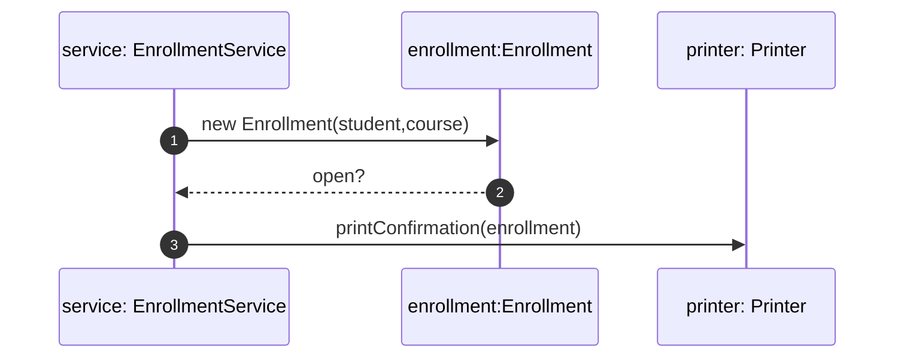
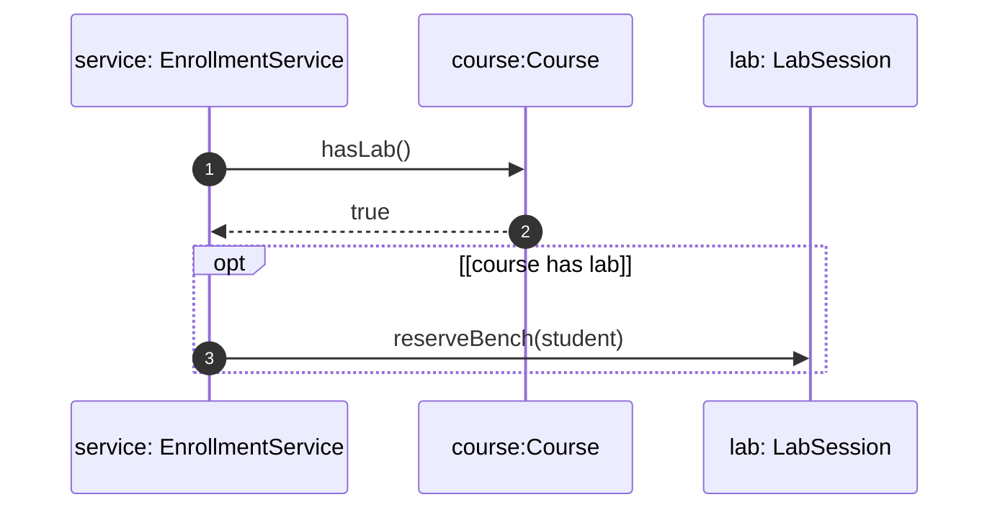
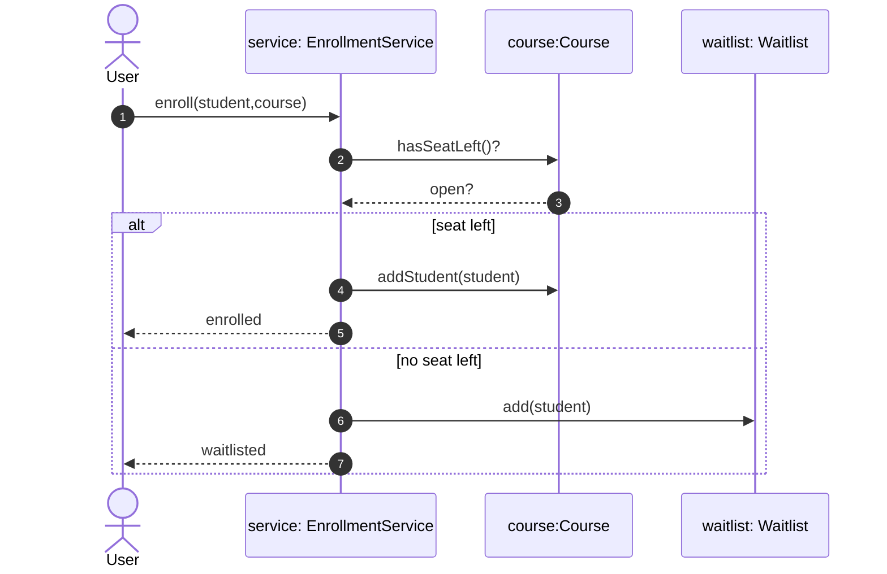
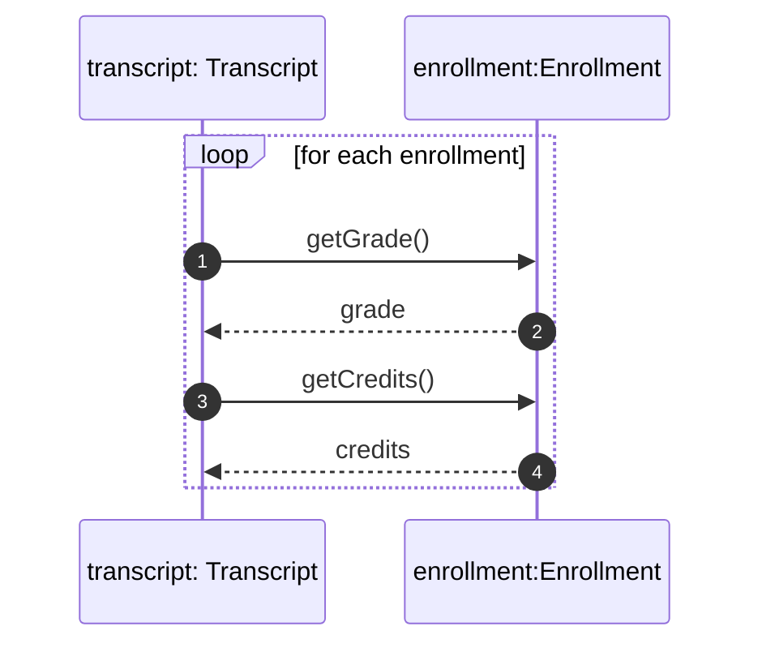
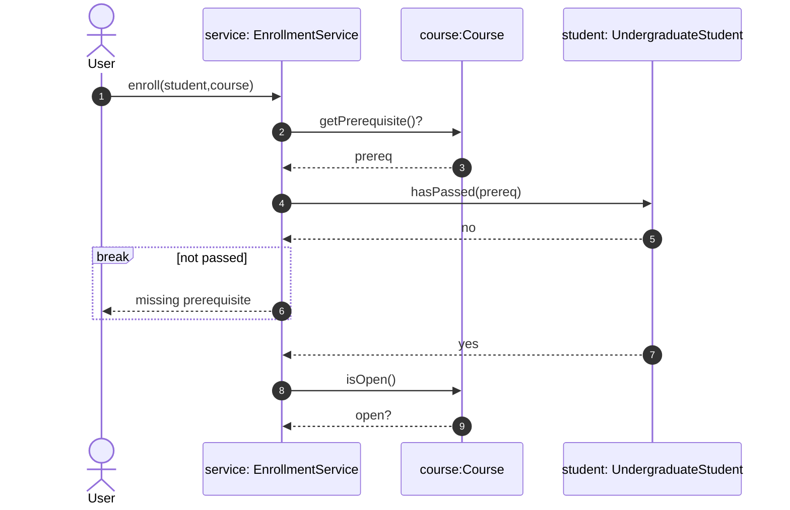
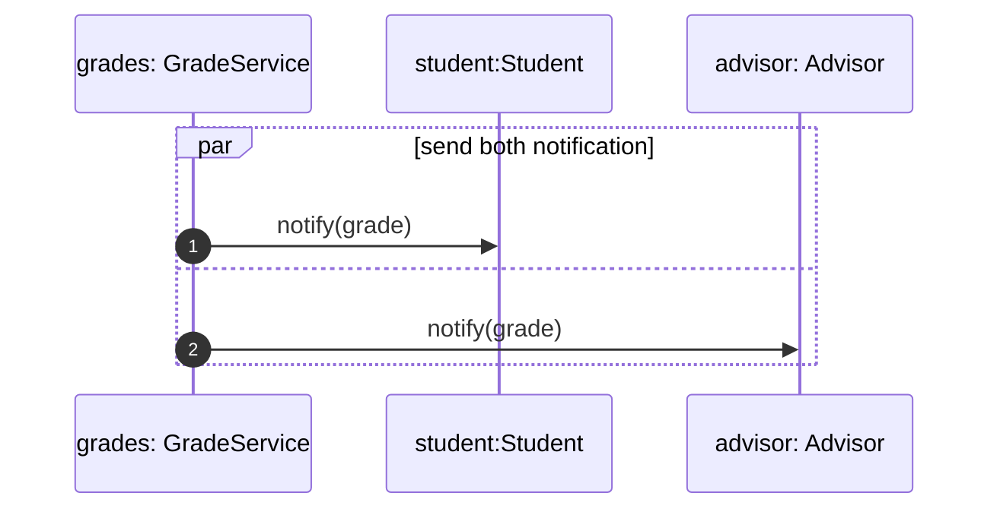
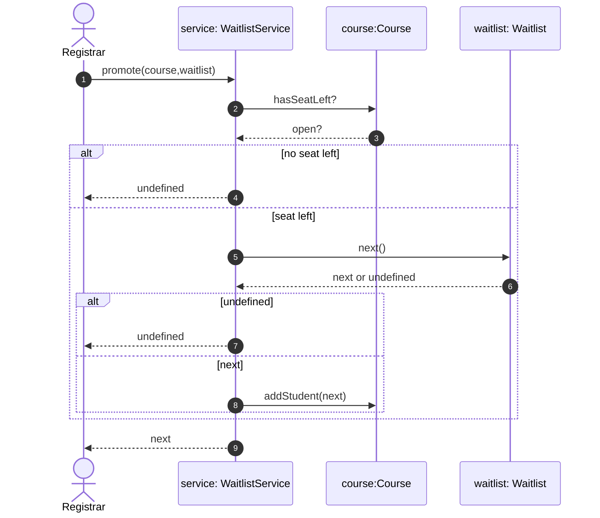
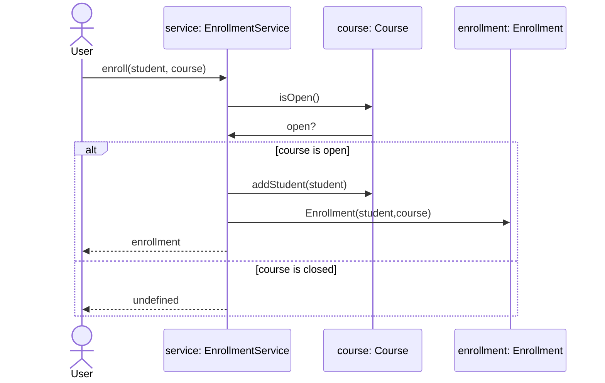

## Exercise 1
* (a) Which messages are returns?
-->(1)The user is asking to the enrollment service to drop a student in a course.
   (2)The Enrollment service asks for removing Student in a that course.
   (3) The course answers yes meaning we can remove that student.
   (4)The enrollment service asks for the credits of that student.
   (5)The course gives it and it is 6 credits.
   (6)The enrollment service removes the number of credits of that student.
   (7)Finally the enrollment service drops that student after everything being done.

* (b) Which operations must `Course` have, and which must `UndergraduateStudent` have? Give the message number of each.
-->`Course` must remove student(2), look(4) and give credits(5),return true if the student is removed(3)  and `UndergraduateStudent` must remove credits (6).

* (c) Suppose the student was never enrolled, so message 3 returns `false`. As drawn, what happens next to the student's credits? Which fragment would you add, and which message numbers would go inside it?
-->Student's credits would be undefined.I would add a break fragment (6) and would return undefined.

## Exercise 2


* (a) Why does the `enrollment` box appear lower than the other two?
-->

* (b) In UML, how is message 2 drawn: what kind of line, and what kind of arrowhead?
-->the message (2) is drawn as a dashed line,open arrow.

## Exercises 3


### Exercise 4

### Exercise 5

### Exercise 6


### Exercise 7


## Exercise 8
|Sentence from the requirements|Fragment|
|---|---|
|"For each course in the student's list, …"|loop|
|"If the student asked for a printed timetable, also print it."|alt|
|"The student pays the fees either by card or by bank transfer."|opt|
|"If registration is closed, refuse and stop."|break|
|"Email the student and the advisor at the same time."|par|

## Exercise 9

## Exercise 10 
```` typescript 
enrollAll(student: Student, courses: Course[]): number{
    let acceptedCourses=0;
    for (const course of courses){
        if (course.isOpen()){
            const credits=course.getCredits();
            if(student.addCredits(credits)){
                acceptedCourses+=1;
            }
        }
    }
    return acceptedCourses;
}

````
## Exercise 11
|\#|Line of the diagram|What is wrong|Correction|
|---|---|---|---|
|1|S->>E: new Enrollment(student, course)|new enrollment must come after checking if the course is open |move it after isOpen() is true|
|2|C->>S: true|The message should use a dashed arrow|C-->>S|
|3|seats=seats-1|we must add student instead of removing seats|addStudent(student)|

* Corrected Diagram
