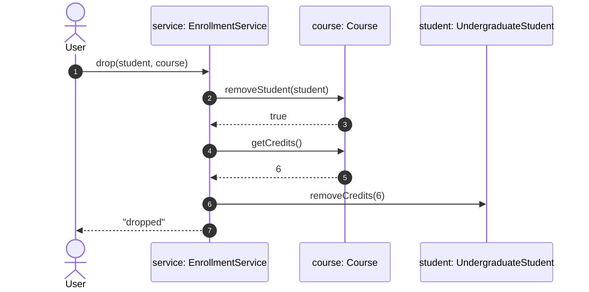
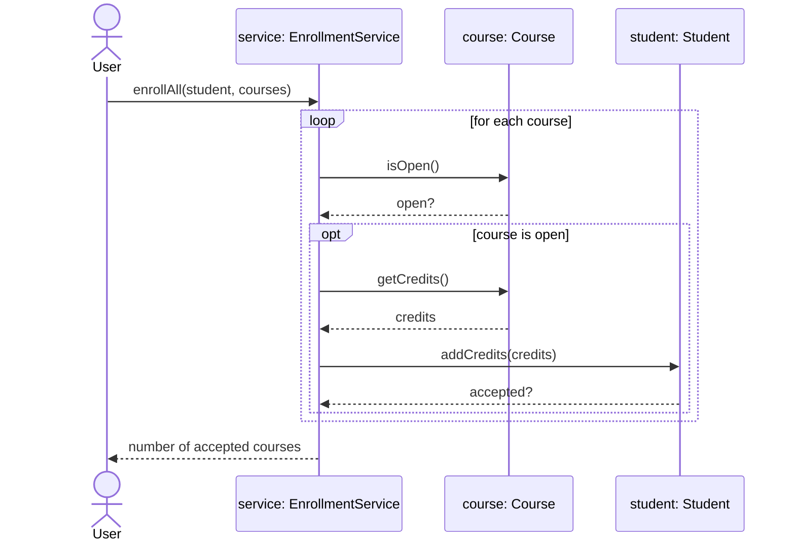
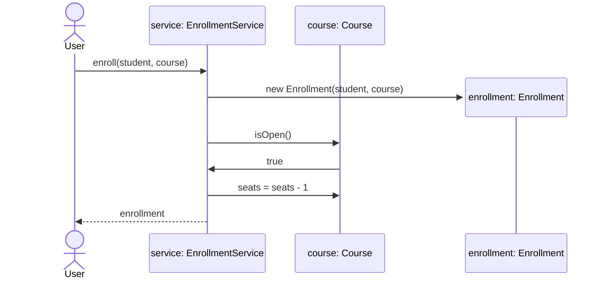

# Object-Oriented Programming — DAUST Fall 2026

# Lab 6 — UML, Part 2: Sequence Diagrams (Course Registration)

Short exercises on the course registration system. Each one practises **one** sequence-diagram skill on a new scenario.

## Setup

Create a folder `oop-lab6` with a file `ANSWERS.md`. Put each answer under its own heading (`## Exercise 3`). Written answers are plain text. Diagrams go in a ```` ```mermaid ```` block. Check that each one renders (`Ctrl+Shift+V` in VS Code); the syntax is in section 3 of the UML–Mermaid cheat sheet.

Rules for every diagram:

1.  **Participants.** Use exactly the participants the exercise lists, with the labels given (`name: Class`). Do not add others.
2.  **Start and end.** Start with the message the exercise names, and stop where it says. Draw an actor only when the exercise lists one.
3.  **Returns.** Draw a return (dashed arrow) only when the caller uses the value. Label it with the value (`6`), or with a question (`open?`) when it can be either answer.
4.  **Created objects.** Write `create participant` on the line just before the `new …` message.
5.  **Guards.** Every path of a fragment has a guard. The wording is yours, for example `course is open`.

---

## Exercise 1 — Read a Diagram

A student drops a course:



Answer with message numbers (the small numbers on the arrows):

* (a) Which messages are returns?
* (b) Which operations must `Course` have, and which must `UndergraduateStudent` have? Give the message number of each.
* (c) Suppose the student was never enrolled, so message 3 returns `false`. As drawn, what happens next to the student's credits? Which fragment would you add, and which message numbers would go inside it?

---

## Exercise 2 — A New Object and a Message That Does Not Wait

**Participants:** `service: EnrollmentService`, `enrollment: Enrollment`, `printer: Printer`. No actor.

Draw only these two messages:

1. The service creates the enrollment: `new Enrollment(student, course)`.
2. The service sends `printConfirmation(enrollment)` to the printer and **does not wait** for the printout.

Then answer in one sentence each:

* (a) Why does the `enrollment` box appear lower than the other two?
* (b) In UML, how is message 2 drawn: what kind of line, and what kind of arrowhead?

---

## Exercises 3–7 — One Fragment Each

Each exercise uses exactly **one** fragment, of the kind in its title.

### Exercise 3 — `opt`

**Participants:** `service: EnrollmentService`, `course: Course`, `lab: LabSession`. No actor.

The service asks the course `hasLab()`. **If** the course has a lab, the service asks the lab to `reserveBench(student)`. Start with `hasLab()`.

### Exercise 4 — `alt`

**Participants:** `User` (actor), `service: EnrollmentService`, `course: Course`, `waitlist: Waitlist`.

The user sends `enroll(student, course)` to the service. The service asks the course `hasSeatLeft()`.

* If a seat is left, it sends `addStudent(student)` to the course and answers the user `"enrolled"`.
* Otherwise, it sends `add(student)` to the waitlist and answers the user `"waitlisted"`.

### Exercise 5 — `loop`

**Participants:** `transcript: Transcript`, `enrollment: Enrollment`. No actor.

To compute a GPA, the transcript asks **each** of the student's enrollments for `getGrade()`, then `getCredits()`. The single `enrollment` lifeline stands for the enrollment of the current turn of the loop. Start with `getGrade()`.

### Exercise 6 — `break`

**Participants:** `User` (actor), `service: EnrollmentService`, `course: Course`, `student: UndergraduateStudent`.

The user sends `enroll(student, course)` to the service. The service asks the course `getPrerequisite()`, which returns `prereq`, then asks the student `hasPassed(prereq)`.

* If the student has **not** passed it, the service answers the user `"missing prerequisite"`, and the scenario stops.
* Otherwise, the service asks the course `isOpen()`. End the diagram with that message and its return.

### Exercise 7 — `par`

**Participants:** `grades: GradeService`, `student: Student`, `advisor: Advisor`. No actor.

When final grades are posted, the grade service sends `notify(grade)` to the student **and** to the advisor, **at the same time**, without waiting for either.

---

## Exercise 8 — Which Fragment?

Copy the table into `ANSWERS.md` and write one fragment (`alt`, `opt`, `loop`, `break` or `par`) per row:

|Sentence from the requirements|Fragment|
|---|---|
|"For each course in the student's list, …"||
|"If the student asked for a printed timetable, also print it."||
|"The student pays the fees either by card or by bank transfer."||
|"If registration is closed, refuse and stop."||
|"Email the student and the advisor at the same time."||

---

## Exercise 9 — From Code to Diagram

```typescript
class WaitlistService {
  promote(course: Course, waitlist: Waitlist): Student | undefined {
    if (!course.hasSeatLeft()) {
      return undefined;
    }
    const next = waitlist.next();
    if (next === undefined) {
      return undefined;
    }
    course.addStudent(next);
    return next;
  }
}
```

**Participants:** `Registrar` (actor), `service: WaitlistService`, `course: Course`, `waitlist: Waitlist`.

Draw the diagram, starting with the registrar's message `promote(course, waitlist)`. Show all **three** ways the method can end, with the value returned in each. `next` is the student returned by the waitlist: it appears as a value on the arrows, not as a participant.

This exercise may use **more than one** fragment.

---

## Exercise 10 — From Diagram to Code



In a ```` ```typescript ```` block in `ANSWERS.md`, write **only the method** `enrollAll(student: Student, courses: Course[]): number`, as it would appear inside the class `EnrollmentService`. You do not need to write the other classes or run the code.

* ` Course`has `isOpen(): boolean` and `getCredits(): number`.
* ` Student`has `addCredits(amount: number): boolean`. It returns `true` when the credits were accepted.
* The method returns how many courses were accepted. Counting is local work inside the method, so the diagram does not show it.

---

## Exercise 11 — Find Three Mistakes



This diagram has **three** mistakes. It also shows only one path, but that is not one of the three: you add the missing path in the correction.

1. Copy this table and fill in one row per mistake. In the second column, copy the Mermaid line that is wrong.

|\#|Line of the diagram|What is wrong|Correction|
|---|---|---|---|
|1||||
|2||||
|3||||

1. Draw the corrected diagram, with the same participants. It must show both paths: the course is open, or the course is closed (the user then gets `undefined`). To take a seat, use `addStudent(student)`.

---

## Deliverables

Push `oop-lab6/ANSWERS.md` to your repository. Open it on GitHub and check that every diagram renders: a diagram that shows **Syntax error** counts as missing.